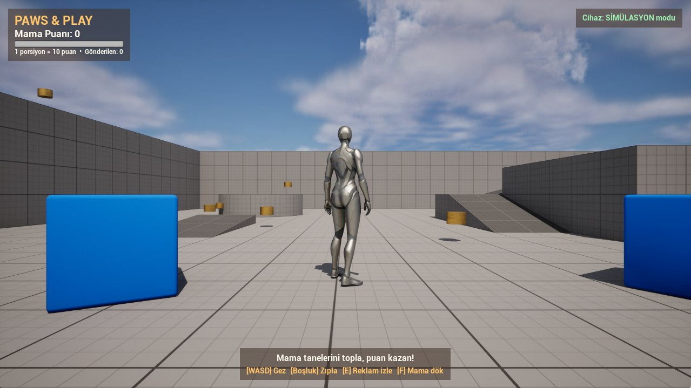
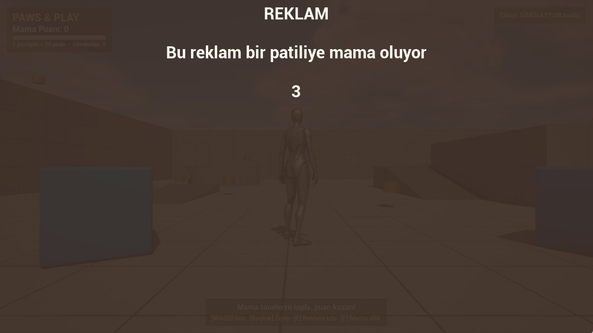
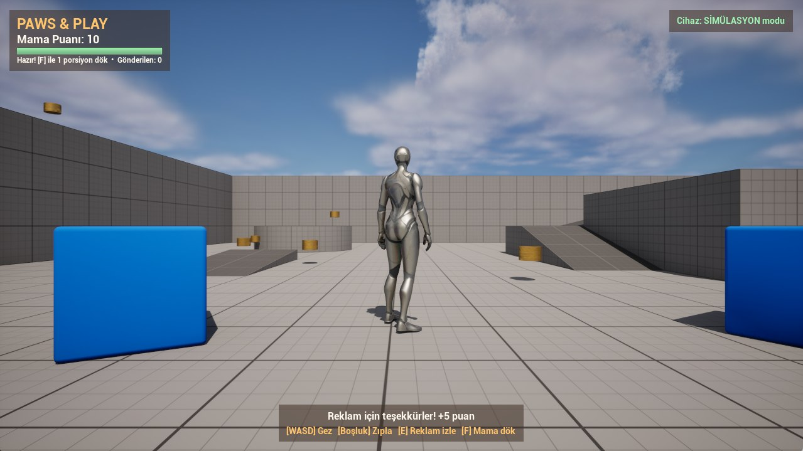

# Paws & Play

Oyun oynayarak uzaktaki gerçek bir otomatik mama kabından sokak hayvanlarına mama döken Unreal Engine 5 prototipi.

> **Proje durumu:** Prototip / Geliştirme aşamasında  
> **Hedef platform:** Windows PC + ESP32 tabanlı mama kabı  
> **Motor:** Unreal Engine 5.4 (C++)

---

## Genel Bakış

Paws & Play, kısa bir oyun oturumunu gerçek dünyada görülebilir bir sonuca bağlar. Oyuncu sahnede mama taneleri toplayarak veya reklam izleyerek **Mama Puanı** kazanır. Yeterli puana ulaşınca **[F] Mama dök** der; oyun Wi-Fi üzerinden ESP32'ye istek gönderir, servo kapağı açar ve bir porsiyon mama kaba düşer.

Cihazın durumu (bugünkü porsiyon sayısı, bekleme süresi, çevrimiçi/çevrimdışı) oyuna geri gelir ve oyuncunun mama dökme imkânını belirler.

**Seçilen kapsam:** *Oyun dışı veri* + *Probleme çözüm*.

## Ekip

| Üye | GitHub | Rol |
|---|---|---|
| Gürkan Lale | [@N4kr0G](https://github.com/N4kr0G) | Oyun programlama: C++ oyun döngüsü, arayüz, cihaz HTTP istemcisi |
| Kaan Efe Çolakoğlu | [@kaanefecolakoglu7-lab](https://github.com/kaanefecolakoglu7-lab) | Donanım: ESP32 firmware, servo bağlantısı, cihaz limitleri |

## Amaç ve Hedefler

- **Hedef kitle:** Sokak hayvanlarına ve barınaklara uzaktan katkı vermek isteyen, kısa oturumlarda oynayan genç yetişkin kullanıcılar.
- **Problem:** Mama noktalarının düzenli doldurulması emek ve maliyet gerektirir; bağışçılar katkılarının somut sonucunu çoğu zaman göremez.
- **Çözüm:** Oyundaki puan harcama, gerçek dünyada bir porsiyon mamaya dönüşür.
- **Güvenlik:** Hayvanın aşırı beslenmesini önleyen limitler oyunda değil **cihazda** uygulanır.
- **Başarı göstergesi:** Test oyuncusunun yönlendirme olmadan 3 dakika içinde ilk porsiyonu dökebilmesi; cihazın limitler dışında hiç mama dökmemesi.

## Oynanış

**Çekirdek döngü:** Gez → mama tanesi topla (+1) / reklam izle (+5) → 10 puana ulaş → mama dök → cihaz onaylar → tekrar.

| Tuş | Eylem |
|---|---|
| WASD / fare | Hareket / kamera |
| Boşluk | Zıpla |
| E | Reklam izle (+5 puan, 30 sn bekleme) |
| F | 1 porsiyon mama dök (10 puan) |

**Kurallar**

- Puan yalnızca cihaz `200` döndüğünde düşülür; bağlantı hatası, bekleme veya limit durumunda puan korunur.
- Cihaz porsiyonlar arasında 60 sn bekler ve günde en fazla 20 porsiyon döker. Oyun çok sayıda istek gönderse bile cihaz reddeder.

**Veri akışı**

```text
UE5 oyun ──POST /feed (X-Feeder-Key)──▶ ESP32 ──▶ servo kapak ──▶ mama kabı
        ◀──GET /status (10 sn'de bir)── {"portionsToday","maxPerDay","cooldownLeft"}
```

**Veri yokken:** `FeederUrl` boşsa oyun **SİMÜLASYON** modunda çalışır (donanımsız demo). URL girili ama cihaz yanıt vermiyorsa arayüzde kırmızı “ÇEVRİMDIŞI” görünür ve puan harcanmaz.

## Mevcut Kapsam

Proje adım adım geliştiriliyor. Aşağıdaki tablo şu anki durumu gösterir.

| Alan | Açıklama | Durum |
|---|---|---|
| Oyun döngüsü | Mama tanesi toplama, puan, mama dökme | Tamamlandı |
| Arayüz (HUD) | Puan, ilerleme çubuğu, cihaz durumu, reklam ekranı | Tamamlandı |
| Simülasyon modu | Donanım olmadan oynanabilir demo | Tamamlandı |
| ESP32 firmware | `/status` ve `/feed` uçları, bekleme ve günlük limit | Tamamlandı |
| Donanım montajı | Kap, servo ve porsiyon kalibrasyonu | Planlandı |
| Kullanıcı testi | En az 3 kullanıcı ile test ve düzeltmeler | Planlandı |
| Gerçek reklam | Simüle reklam yerine reklam SDK'sı | Planlandı |
| Uzak erişim | Farklı ağlardan cihaza bağlanma | Planlandı |

## Teknoloji Yığını

| Teknoloji | Amaç |
|---|---|
| [Unreal Engine 5.4](https://www.unrealengine.com/) | Oyun motoru |
| C++ | Oyun mantığı, arayüz ve HTTP istemcisi |
| ESP32 DevKit (Arduino) | Mama kabındaki Wi-Fi HTTP sunucusu |
| SG90 / MG90S servo | Mama kapağını açıp kapatma |
| ESP32Servo kütüphanesi | Servo kontrolü |

## Başlangıç

### Gereksinimler

- Unreal Engine **5.4**
- Visual Studio 2022 (veya Build Tools), “C++ ile masaüstü geliştirme” iş yükü
- Git
- Donanım için (isteğe bağlı): ESP32 DevKit, SG90/MG90S servo, mama haznesi ve 5 V güç, Arduino IDE

### Depoyu Klonlama

```bash
git clone https://github.com/N4kr0G/PawsAndPlay.git
cd PawsAndPlay
```

### Projeyi Açma

1. `PawsAndPlay.uproject` dosyasına sağ tıklayıp **Generate Visual Studio project files** seçin.
2. `PawsAndPlay.uproject` dosyasını açın; C++ modülü derlenir.
3. **Play**'e basın. Varsayılan olarak simülasyon modunda çalışır.

Komut satırından derlemek için:

```bash
Engine\Build\BatchFiles\Build.bat PawsAndPlayEditor Win64 Development -Project="<yol>\PawsAndPlay.uproject"
```

### Donanımı Kurma (ESP32)

1. Servo sinyal → **GPIO13**, servo VCC → 5 V, GND → GND (ESP32 ile ortak).
2. `Hardware/ESP32Feeder/secrets.example.h` dosyasını `secrets.h` olarak kopyalayıp Wi-Fi bilgilerini ve anahtarı yazın.
3. Arduino IDE'de *ESP32Servo* kütüphanesini kurun ve `ESP32Feeder.ino`'yu yükleyin.
4. Seri monitörde cihazın IP adresini görün.
5. `OPEN_MS` değerini kalibre edin (bir porsiyonun miktarı buna bağlıdır).

### Oyunu Cihaza Bağlama

`Saved/Config/WindowsEditor/Game.ini` (paketli oyunda `Saved/Config/Windows/Game.ini`):

```ini
[/Script/PawsAndPlay.PawsGameMode]
FeederUrl=http://192.168.1.50
FeederKey=secrets.h içindeki FEEDER_KEY
```

> **Not:** Bu dosya depoya girmez; anahtar ve IP depoda tutulmaz.

Cihazı test etmek için tarayıcıdan `http://<ip>/status` açın. Mama dökme:

```bash
curl -X POST -H "X-Feeder-Key: <anahtar>" http://<ip>/feed
```

## Depo Yapısı

```text
PawsAndPlay/
├── Config/                  # Oyun ayarları (puan, porsiyon, reklam)
├── Content/                 # Harita, karakter ve materyaller
├── Docs/                    # Proje formu (docx + pdf), ekran görüntüleri
├── Hardware/
│   └── ESP32Feeder/         # ESP32 firmware'i
├── Source/
│   └── PawsAndPlay/
│       ├── PawsGameMode.*         # Puan, reklam, cihaz HTTP istekleri
│       ├── Kibble.*               # Toplanabilir mama tanesi
│       ├── PawsPlayerController.* # E / F tuşları, HUD oluşturma
│       └── PawsHUDWidget.*        # C++ ile kurulan arayüz
├── PawsAndPlay.uproject
└── README.md
```

## Yol Haritası

- [x] Fikir, hedef kitle ve donanım seçimi (ESP32 + servo).
- [x] Çekirdek döngü, veri akışı ve HTTP API tasarımı.
- [x] C++ oyun döngüsü, arayüz ve simülasyon modu.
- [x] ESP32 firmware'i (bekleme ve günlük limit).
- [ ] Kap ve servo montajı, porsiyon kalibrasyonu.
- [ ] Gerçek cihazla uçtan uca deneme.
- [ ] En az 3 kullanıcı ile test ve düzeltmeler.
- [ ] Paketlenmiş sürüm, ekran görüntüleri ve tanıtım videosu.

| Aşama | Sorumlu | Durum |
|---|---|---|
| Araştırma | Gürkan, Kaan | Tamamlandı |
| Tasarım | Gürkan, Kaan | Tamamlandı |
| İlk prototip | Gürkan (oyun), Kaan (donanım) | Sürüyor |
| Üretim ve test | Kaan (donanım), Gürkan (oyun) | Yapılacak |
| Final | Gürkan, Kaan | Yapılacak |

## Bilinen Sınırlılıklar

- Reklam **simüle** edilir (5 sn sayaç).
- Oyun ve ESP32 **aynı ağda** olmalı. Gerçek uzak erişim için port yönlendirme, tünel veya aracı bir sunucu gerekir.
- Puanlar kaydedilmez; oyun kapanınca sıfırlanır.
- ESP32 günlük sayacı gece yarısı değil, açılıştan itibaren 24 saatte bir sıfırlanır.

## Görseller ve Testler

Aşağıdaki görüntüler simülasyon modunda, bir porsiyonluk tam döngüyü baştan sona gösterir.

| | |
|---|---|
|  |  |
| **1. Başlangıç:** Sol üstte puan ve ilerleme çubuğu, sağ üstte cihaz durumu, altta son mesaj ve tuş ipuçları. Altın renkli silindirler toplanabilir mama taneleri. | **2. Reklam:** [E] ile açılan tam ekran reklam ve geri sayım. Bitince +5 puan, ardından 30 sn bekleme. |
|  |  |
| **3. Hazır:** 10 puana ulaşınca ilerleme çubuğu yeşile döner ve “Hazır! [F] ile 1 porsiyon dök” yazar. | **4. Mama döküldü:** [F] sonrası puan düşer, “Gönderilen” sayacı artar. Gerçek cihazda bu anda servo kapağı açar. |

**Görsel dil:** Koyu yarı saydam paneller üzerinde krem metin; turuncu = eylem ve ilerleme, yeşil = hazır / çevrimiçi, kırmızı = çevrimdışı / hata.

**Testler:** Kullanıcı testi henüz yapılmadı (Üretim ve test aşaması, 16.11–13.12.2026). Plan: en az 3 hedef kullanıcı (K1, K2, K3) yönlendirme olmadan “Mama kabına bir porsiyon mama dök” görevini yapar; ilk porsiyona kadar geçen süre, takılınan adımlar ve arayüz mesajlarının doğru yorumlanması kaydedilir.

## Kaynaklar ve Beyanlar

| İçerik | Kaynak | Lisans |
|---|---|---|
| Third Person şablonu, Starter Content | Epic Games | Unreal Engine EULA |
| ESP32Servo kütüphanesi | Arduino Library Manager | LGPL-2.1 |

**YZ kullanımı:** Claude Code (Anthropic) ile C++ oyun kodu, ESP32 firmware taslağı, README ve proje formu taslağı hazırlandı. Kod derlendi ve oyun içinde çalıştırılarak doğrulandı.

## Lisans

Bu depo için henüz açık kaynak lisansı seçilmedi. Lisans eklenene kadar tüm haklar saklıdır.

---

**Unreal Engine ile ve patili dostlarımız için geliştirildi.** 🐾
